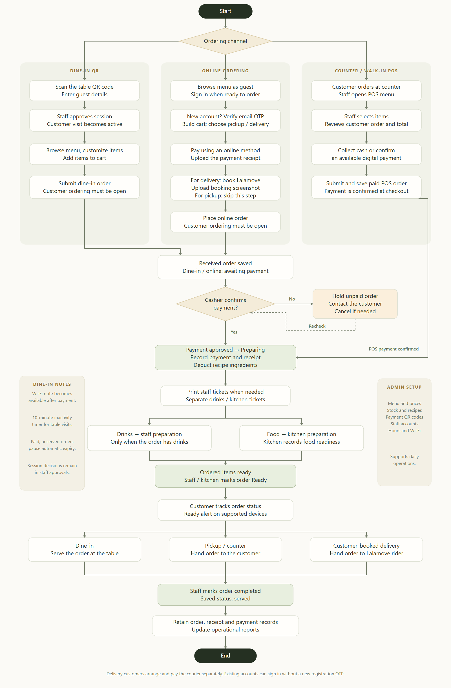

# Ordering system flowchart

Files: [PDF](QUVO-ORDERING-FLOWCHART.pdf), [editable SVG](QUVO-ORDERING-FLOWCHART.svg), and [Mermaid source](QUVO-ORDERING-FLOWCHART.mmd).

The flowchart covers dine-in QR, online pickup and customer-booked Lalamove, counter POS, cashier payment approval, recipe stock deduction, receipts, department tickets, preparation, readiness, fulfillment and reporting. Side notes cover dine-in Wi-Fi, inactivity timers and admin settings. The rendered diagram omits the title and subtitle banner. The Mermaid version also expands the unpaid cancellation branch.

The PDF is a single A3 portrait page. The PNG and PDF are rendered from the SVG. These files document the system and do not change application behavior.
